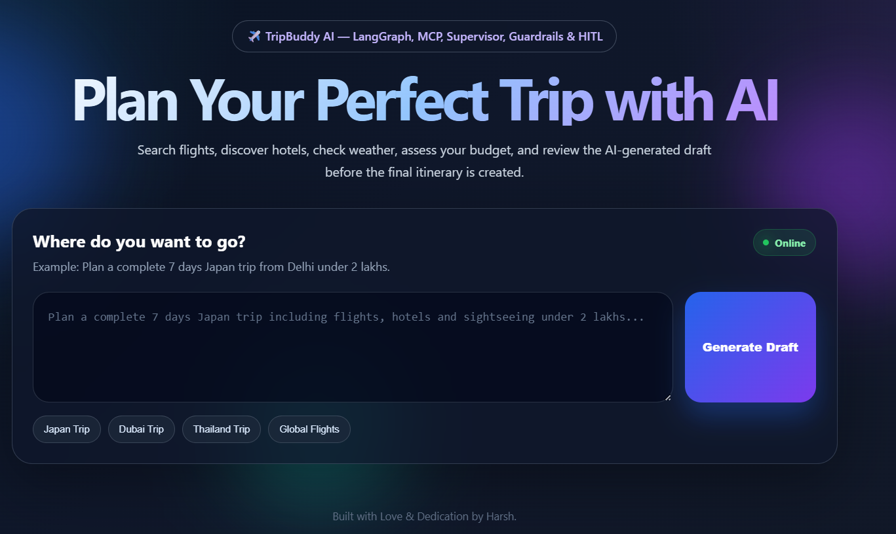
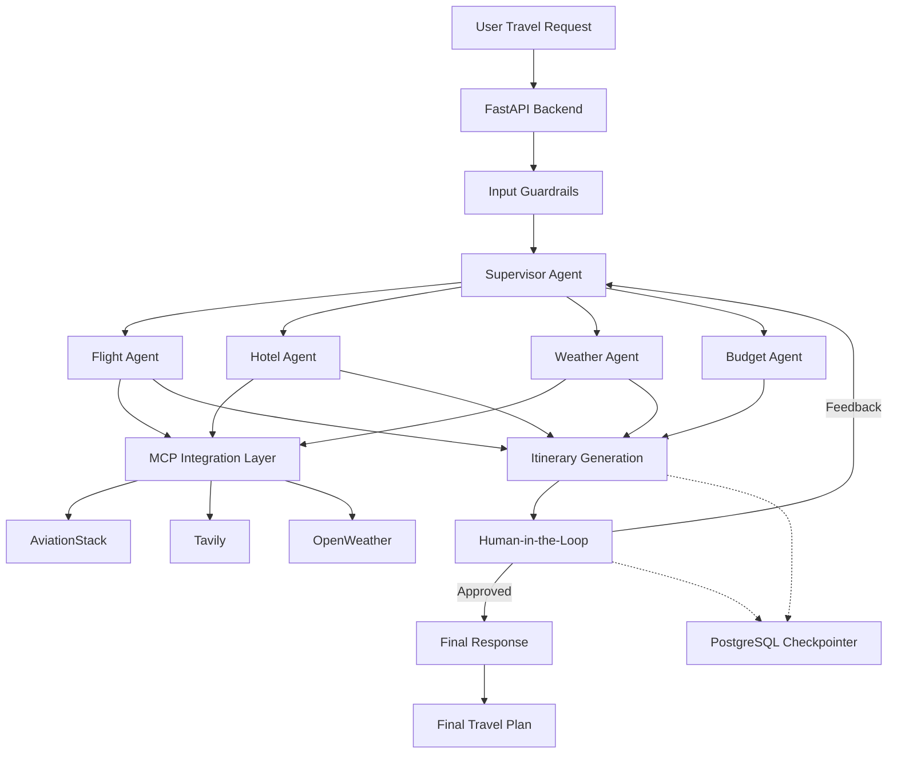

# ✈️ TripBuddy AI – Multi-Agent Travel Planner

### Plan Your Perfect Trip with AI | LangGraph • MCP • Supervisor • Guardrails • Human-in-the-Loop

<p align="center">
  <a href="https://multi-agent-travel-planner-using.onrender.com/">
    
  </a>
  
  
  
  
</p>

**TripBuddy AI** is an intelligent, multi-agent travel planning application built using **LangGraph, Large Language Models (LLMs), and Model Context Protocol (MCP)**. It leverages a Supervisor-based architecture to coordinate specialized AI agents, retrieve real-time information from external services, and generate personalized travel itineraries.

The system brings together flight search, hotel research, weather forecasting, budget analysis, and itinerary generation into a unified workflow. With integrated **Guardrails and Human-in-the-Loop (HITL)** mechanisms, users can review and provide feedback on AI-generated travel plans before the final itinerary is created.

## 🌐 Live Application

**Try TripBuddy AI:** [https://multi-agent-travel-planner-using.onrender.com/](https://multi-agent-travel-planner-using.onrender.com/)

## 📸 Application Preview

<p align="center">
  
</p>

*TripBuddy AI provides an interactive interface where users can describe their travel requirements and generate AI-powered travel plans.*

---

## 🌟 Key Features

- **Multi-Agent Architecture:** Uses specialized AI agents to handle different aspects of travel planning through collaborative execution.
- **Supervisor-Based Orchestration:** A central Supervisor analyzes user requirements and dynamically routes tasks to appropriate agents.
- **Input Guardrails:** Validates incoming requests and ensures that the workflow handles relevant travel-planning queries.
- **MCP Integration:** Connects AI agents with external services through the Model Context Protocol (MCP), providing a modular tool-integration layer.
- **Flight Information:** Integrates AviationStack to retrieve flight-related information.
- **Hotel & Destination Research:** Uses Tavily for web-based hotel and destination research.
- **Weather Intelligence:** Integrates OpenWeather through a custom MCP server to retrieve current weather conditions and forecasts.
- **Budget Analysis:** Evaluates estimated travel expenses and provides budget-conscious recommendations.
- **Intelligent Itinerary Generation:** Combines information from different agents to generate structured and personalized travel plans.
- **Human-in-the-Loop (HITL):** Allows users to review AI-generated itineraries, approve them, or request modifications.
- **Persistent State Management:** Uses PostgreSQL checkpointing to preserve LangGraph workflow states and support interrupted workflow resumption.
- **Cloud Deployment:** Containerized using Docker and deployed on Render.

---

## 🏗️ System Architecture

TripBuddy AI follows a **Supervisor-driven multi-agent architecture** in which a central Supervisor coordinates specialized agents based on the user's travel requirements.

### High-Level Architecture



### Workflow Explanation

1. **User Request:** Users submit their travel requirements, including destination, departure location, travel dates, duration, and budget.
2. **Input Guardrails:** The system validates the incoming request before processing.
3. **Supervisor Agent:** Analyzes the request, extracts relevant constraints, and determines which specialized agents should execute.
4. **Specialized Agents:** Relevant agents handle flight information, hotel research, weather analysis, and budget evaluation.
5. **MCP Tool Integration:** Agents interact with external services through MCP tools to retrieve relevant information.
6. **Itinerary Generation:** The itinerary workflow combines the available information into a structured travel plan.
7. **Human-in-the-Loop:** Execution pauses to allow the user to review the generated itinerary.
8. **Feedback & Revision:** Users can approve the plan or provide feedback for modifications.
9. **Final Response:** The final workflow incorporates the user's decision and produces the final travel plan.
10. **State Persistence:** PostgreSQL checkpointing maintains workflow state and supports resuming interrupted executions.

---

## 🤖 Specialized AI Agents

| Agent | Responsibility |
|---|---|
| **Supervisor Agent** | Analyzes user requests, extracts travel constraints, and dynamically routes tasks to relevant agents. |
| **Flight Agent** | Retrieves flight-related information using AviationStack through MCP. |
| **Hotel Agent** | Researches accommodation options and destination information using Tavily. |
| **Weather Agent** | Retrieves current weather conditions and forecasts using OpenWeather through a custom MCP server. |
| **Budget Agent** | Evaluates estimated travel expenses and provides budget-related recommendations. |
| **Itinerary Agent** | Combines outputs from specialized agents to generate a structured travel itinerary. |
| **Final Response Agent** | Produces the final response after incorporating human approval and revision feedback. |

---

## 🔄 Human-in-the-Loop (HITL)

A key component of TripBuddy AI is its Human-in-the-Loop implementation using LangGraph.

Instead of directly presenting an AI-generated itinerary as the final output, the system introduces a human approval checkpoint.

**How it works:**

1. The itinerary workflow generates an initial travel plan.
2. LangGraph's `interrupt()` mechanism pauses workflow execution.
3. The generated itinerary is presented to the user for review.
4. The user can approve the itinerary or request modifications by providing feedback.
5. The workflow resumes using LangGraph's `Command(resume=...)` mechanism.
6. The final response incorporates the user's decision and feedback.

This approach provides greater user control, transparency, and flexibility in AI-generated travel recommendations.

---

## 🔌 Model Context Protocol (MCP) Integration

The project uses **Model Context Protocol (MCP)** to connect specialized AI agents with external tools and services.

MCP provides a standardized communication layer between agents and external data sources, making the system more modular and extensible.

| Integration | Technology | Purpose |
|---|---|---|
| Flight Information | AviationStack | Flight and airline-related information |
| Web Research | Tavily | Hotel and destination research |
| Weather Services | Custom FastMCP Server + OpenWeather | Current weather conditions and forecasts |

A dedicated MCP client manages tool connections and allows agents to access the required services without tightly coupling agent logic to individual API implementations.

---

## 🛠️ Technology Stack

| Category | Technologies |
|---|---|
| Programming Language | Python |
| Agent Orchestration | LangGraph |
| LLM Integration | LangChain, Groq |
| Tool Integration | Model Context Protocol (MCP) |
| MCP Framework | FastMCP, LangChain MCP Adapters |
| Backend Framework | FastAPI |
| Flight Information | AviationStack |
| Web Search | Tavily |
| Weather Services | OpenWeather |
| Database & Persistence | PostgreSQL, Psycopg |
| Frontend | HTML, CSS, JavaScript |
| Containerization | Docker |
| Deployment | Render |

---

## 📂 Project Structure

```text
Multi-Agent-Travel-Planner/
│
├── app.py
│   └── FastAPI application and API endpoints
│
├── backend.py
│   └── LangGraph workflow, agent implementations,
│       Supervisor logic, Guardrails and HITL
│
├── mcp_client.py
│   └── MCP client configuration and tool integration
│
├── custom_weather_mcp_server.py
│   └── Custom MCP server for weather services
│
├── templates/
│   └── Frontend HTML templates
│
├── static/
│   ├── style.css
│   └── script.js
│
├── assets/
│   └── tripbuddy-homepage.png
│
├── requirements.txt
│   └── Python dependencies
│
├── Dockerfile
│   └── Docker configuration for deployment
│
└── .gitignore
    └── Files excluded from version control
```

---

## ⚙️ Installation & Setup

Follow these steps to run the project locally.

### 1. Clone the Repository

```bash
git clone https://github.com/harshmotiramani2002/Multi-Agent-Travel-Planner-using-LangGraph-MCP-Supervisor-Guardrails-HITL.git

cd Multi-Agent-Travel-Planner-using-LangGraph-MCP-Supervisor-Guardrails-HITL
```

### 2. Create a Virtual Environment

```bash
python -m venv venv
```

Activate the environment:

**Windows:**
```bash
venv\Scripts\activate
```

**Linux / macOS:**
```bash
source venv/bin/activate
```

### 3. Install Dependencies

```bash
pip install -r requirements.txt
```

### 4. Configure Environment Variables

Create a `.env` file in the root directory and configure the required API credentials.

```env
GROQ_API_KEY=your_groq_api_key
TAVILY_API_KEY=your_tavily_api_key
AVIATIONSTACK_API_KEY=your_aviationstack_api_key
OPENWEATHER_API_KEY=your_openweather_api_key
DATABASE_URL=your_postgresql_connection_url
```

**Note:** Use the exact environment variable names expected by the application code. Ensure that your PostgreSQL database is active and accessible before starting the application.

### 5. Run the Application

Start the FastAPI application using Uvicorn:

```bash
uvicorn app:app --host 0.0.0.0 --port 8000
```

### 6. Access the Application

Open your browser and navigate to:

```text
http://localhost:8000
```

---

## 🚀 Deployment

The application is containerized using **Docker** and deployed as a web service on **Render**.

The deployment setup includes:

- Docker-based application packaging.
- FastAPI application served using Uvicorn.
- Environment-based configuration for API credentials.
- PostgreSQL integration for persistent LangGraph checkpoints.
- Cloud-hosted backend accessible through a web interface.

**Live Application:** [Launch TripBuddy AI](https://multi-agent-travel-planner-using.onrender.com/)

---

## 🧠 Key Engineering Concepts

This project demonstrates practical implementation of several concepts in modern AI application development:

- **Multi-Agent Systems:** Designing specialized agents with clearly defined responsibilities.
- **Supervisor Architecture:** Implementing centralized agent selection and workflow orchestration.
- **Stateful AI Workflows:** Managing shared state and conditional transitions using LangGraph.
- **MCP-Based Integrations:** Connecting AI agents with external services through a standardized tool interface.
- **AI Guardrails:** Validating incoming requests before executing the workflow.
- **Human-in-the-Loop:** Implementing approval and revision mechanisms using graph interruptions and resumptions.
- **Persistent Checkpointing:** Maintaining workflow state using PostgreSQL.
- **API Development:** Building backend services and endpoints using FastAPI.
- **Cloud Deployment:** Containerizing and deploying an AI-powered application using Docker and Render.

---

## 🔮 Future Enhancements

- Integration with additional travel and booking service providers.
- More advanced itinerary personalization based on user preferences.
- Enhanced error handling and retry mechanisms for external API failures.
- Improved travel cost estimation and optimization.
- Additional MCP servers and specialized travel agents.
- Comprehensive automated testing and monitoring.

---

## 👨‍💻 Author

**Harsh Motiramani**

Electrical Engineering Undergraduate | IIT (BHU), Varanasi

Interested in Software Development, Artificial Intelligence, Multi-Agent Systems, and Backend Engineering.

- **GitHub:** [harshmotiramani2002](https://github.com/harshmotiramani2002)
- **LinkedIn:** [Harsh Motiramani](https://linkedin.com/in/harsh-motiramani-1877232a8/)

---

<p align="center">
  <b>Built with ❤️ and dedication by Harsh Motiramani</b>
  <br/>
  ⭐ If you find this project interesting, consider giving the repository a star!
</p>
